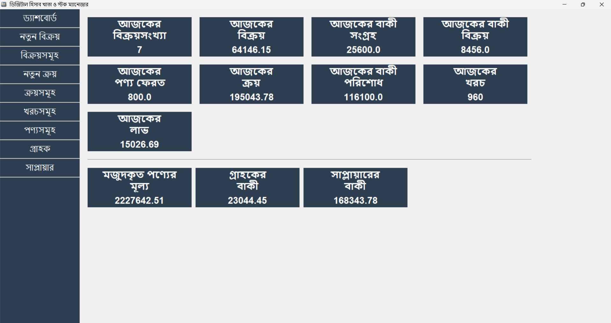
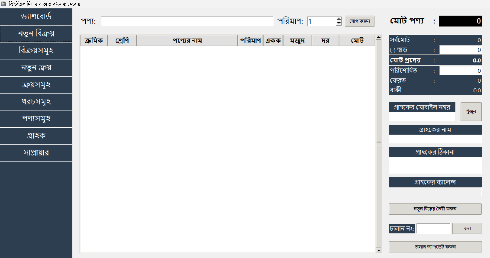
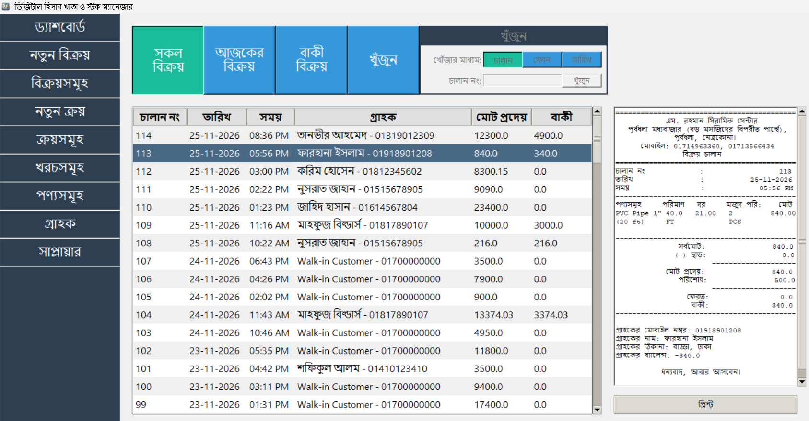
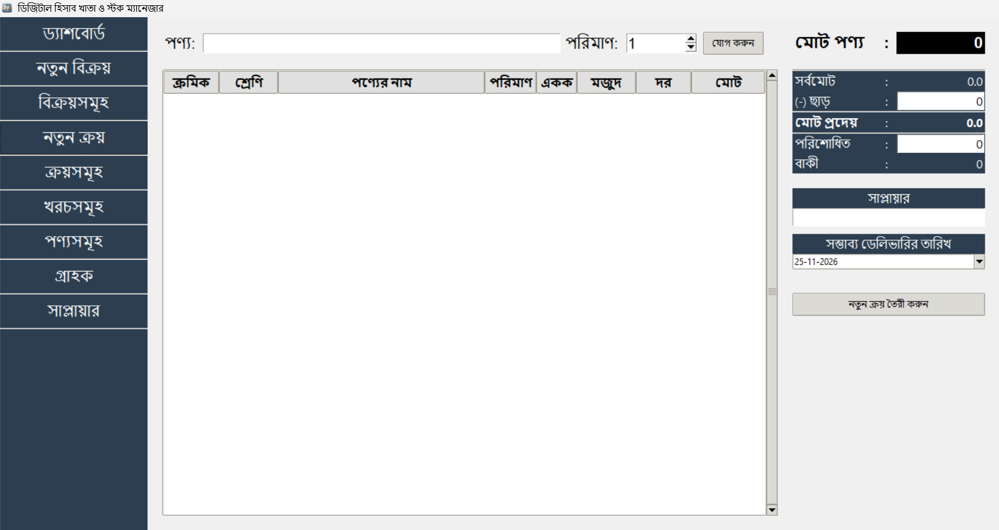
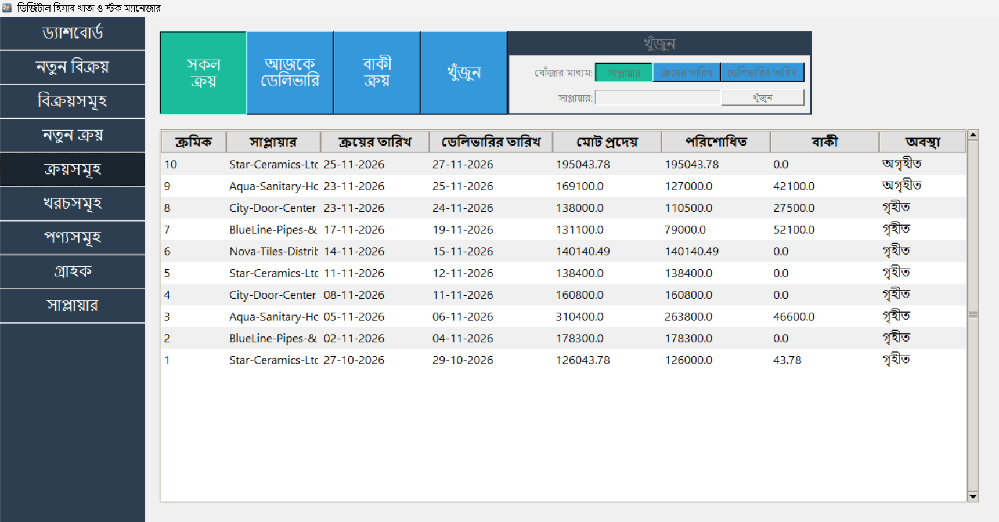
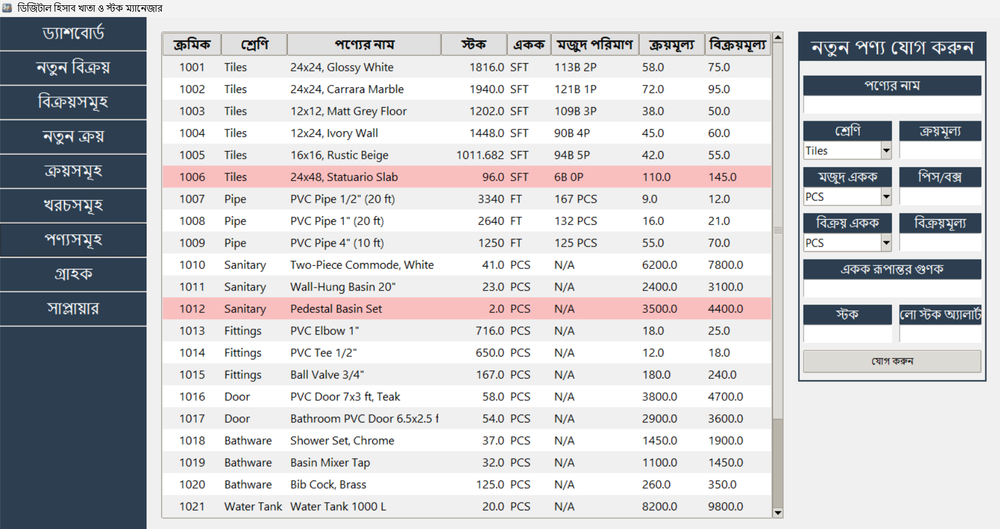
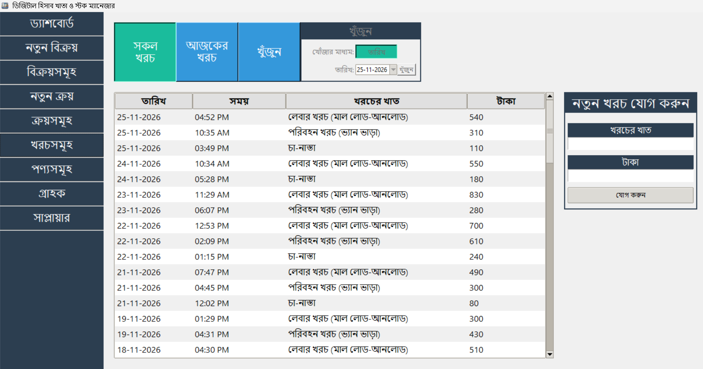
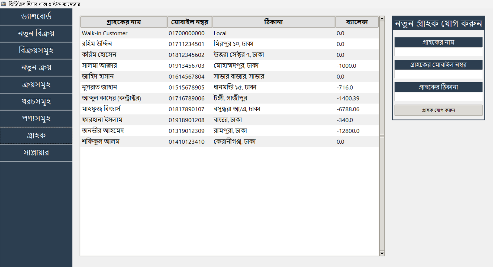
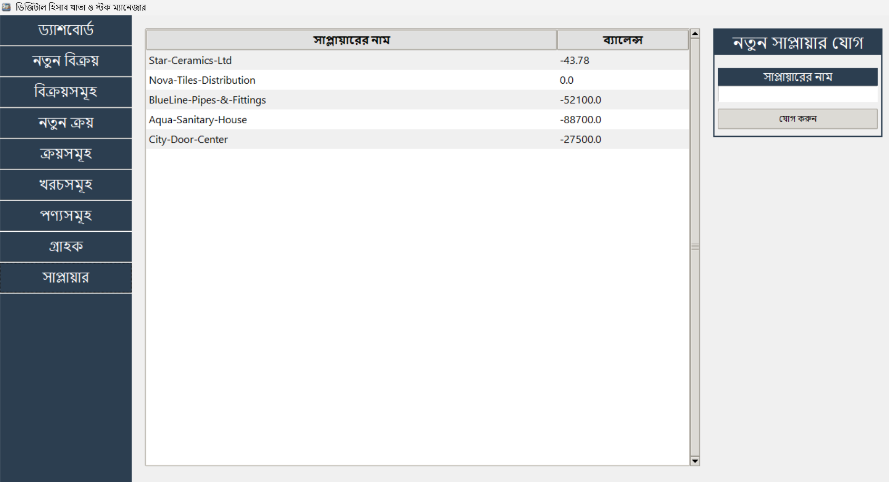

<div align="center">


# Digital Hisab Khata & Stock Manager

**A Bangla-language desktop point-of-sale, accounting and inventory app for small retail shops.**

It replaces the traditional paper *hisab khata* (ledger book): sales, purchases, stock, customer and supplier dues, expenses and daily profit all live in one offline app.


</div>

---

## 📖 About the project

Many small shops in Bangladesh still run their business from a handwritten ledger. They track who owes money, what came in from suppliers, and what is left on the shelf by hand. This app moves that whole workflow to a **fast, offline desktop app with a fully Bangla interface**, so shop owners and staff can use it without learning English software terms.

It was built for a **tiles, sanitary and hardware shop**, which brings some unusual problems. Tiles are sold by the **square foot (sft)** but stocked in **boxes and pieces**. Pipes are sold by the **foot** but stocked by the **length**. The app handles these unit conversions automatically on every sale, purchase and stock update.

## ✨ Features

### 📊 Dashboard: the day at a glance
Live summary cards (right-click to refresh):
- Today's number of sales, sales value, credit (due) sales and due collected
- Today's sales returns, purchases, supplier payments and expenses
- **Today's profit**, calculated per item as sell price minus purchase rate
- Total **stock valuation**, total **customer dues** and total **supplier dues**

### 🧾 Sales and invoicing (point of sale)
- Add products by **name/code autocomplete** or with a **barcode scanner** (8+ digit codes are picked automatically)
- Edit quantity and unit price inline; set a discount and see the total, paid, change and due update live
- Look up customers by phone number, with a built-in *Walk-in Customer* for cash sales
- **Thermal-printer-ready Bangla invoices** (43-column receipt layout) sent straight to the default Windows printer
- Recall and update an existing invoice

### 📚 Sales history
- Filter by **today**, **due invoices**, **invoice number**, **customer phone** or a **date range** (calendar picker)
- View or reprint any invoice
- **Collect due payments** against an invoice, with a full payment history
- **Sales returns / refunds** per item, with stock restored automatically
- Delete invoices

### 🚚 Purchases and suppliers
- Create purchase orders with a purchase date, expected delivery date, paid amount and due
- Mark orders as **received**, which updates stock
- Filter by **today's deliveries**, **due purchases**, **supplier**, **purchase date** or **delivery date**
- **Pay supplier dues** and **return items to suppliers**
- Supplier profiles with a running balance and a **supplier statement** (ledger)

### 📦 Products and inventory
- Product categories: Tiles, Sanitary, Pipe, Fittings, Door, Bathware, Water Tank, Accessories, Others
- Separate **base (stock) unit** and **sell unit**, with a conversion factor and pieces-per-box
- **Smart unit conversion**:
  - **Tiles**: the size is read from the product name (e.g. `24x24, Glossy White`). Requested sft is rounded up to whole tiles and shown as `xB yP` (boxes + pieces)
  - **Pipes**: requested feet are rounded to whole pipe lengths
- Low-stock alert threshold per product
- Inline editing and deletion from the product table

### 👥 Customers
- Customer profiles with phone, address and **running balance**
- **Deposit advance balance**
- **Customer statement** showing every transaction with its running balance

### 💸 Expenses
- Record daily shop expenses (purpose + amount)
- View today's, all, or a specific date's expenses, with inline editing and deletion

## 📸 Screenshots

**Dashboard (ড্যাশবোর্ড)**: the day's sales, dues, purchases, expenses and profit at a glance



| New sale (নতুন বিক্রয়) | Sales history and receipt (বিক্রয়সমূহ) |
|---|---|
|  |  |

| New purchase (নতুন ক্রয়) | Purchases (ক্রয়সমূহ) |
|---|---|
|  |  |

| Products and stock (পণ্যসমূহ) | Expenses (খরচসমূহ) |
|---|---|
|  |  |

| Customers (গ্রাহক) | Suppliers (সাপ্লায়ার) |
|---|---|
|  |  |

## 🛠️ Tech stack

| Layer | Technology |
|---|---|
| Language | Python 3.12+ |
| GUI | Tkinter + ttk (`clam` theme), `tkcalendar` for date pickers |
| Database | SQLite |
| ORM | SQLAlchemy 2.0 (typed `Mapped[...]` declarative models) |
| Printing | `pywin32` (`win32print` / `win32ui`) for direct receipt printing |
| Config | `python-dotenv` for shop details on the invoice |

## 🗂️ Project structure

```
digital-hisab-khata-and-stock-manager/
├── main.py                      # App entry point: window, sidebar navigation, frame routing
├── ui/
│   ├── dashboard.py             # Daily summary cards & KPIs
│   ├── sales_management.py      # New sale (POS), sales history, refunds, due collection
│   ├── purchases_management.py  # New purchase, purchase history, supplier returns & payments
│   ├── product_management.py    # Product catalogue & stock
│   ├── customer_management.py   # Customers, deposits, customer statements
│   ├── supplier_management.py   # Suppliers, deposits, supplier statements
│   └── expenses_management.py   # Daily expenses
├── utils/
│   ├── dbmodels.py              # SQLAlchemy ORM models (13 tables)
│   ├── database_management.py   # Engine, session & data-access functions
│   └── helpers.py               # Invoice builder, printing, validators, autocomplete, unit conversion
├── scripts/
│   └── seed_demo_data.py        # Fills the database with fictional demo data
├── screenshots/                 # README screenshots
├── img/                         # App icon
├── database/                    # SQLite database file is created here on first run (git-ignored)
├── .env.example                 # Shop details template for invoices
└── requirements.txt
```

## 🧩 Data model

The schema is built from relational SQLAlchemy models:

```
Customer ──< Invoice ──< SaleItem ──< Refund
   │            └──< CustomerDuePayment
   └──< CustomerStatement

Supplier ──< Purchase ──< PurchaseItem ──< PurchaseRefund
   │            └──< SupplierDuePayment
   └──< SupplierStatement

Product          (referenced by SaleItem & PurchaseItem)
Expense
```

## 🚀 Getting started

> **Note:** Invoice printing uses the Windows printing API (`pywin32`), so the app is meant to run on **Windows**.

### Prerequisites
- Windows 10 / 11
- Python **3.12 or newer** (the code uses nested same-quote f-strings from PEP 701)
- A Bangla-capable font (Windows ships with *Nirmala UI*, which works)
- *(Optional)* A thermal receipt printer set as the default printer

### Installation

```bash
# 1. Clone the repository
git clone https://github.com/ethicalmahim/digital-hisab-khata-and-stock-manager.git
cd digital-hisab-khata-and-stock-manager

# 2. Create and activate a virtual environment
python -m venv .venv
.venv\Scripts\activate

# 3. Install dependencies
pip install -r requirements.txt

# 4. Set up your shop details for the invoice header
copy .env.example .env
```

Edit `.env` with your shop's details:

```env
SHOP_NAME="দোকানের নাম"
SHOP_ADDRESS_1="দোকানের ঠিকানা ১"
SHOP_ADDRESS_2="দোকানের ঠিকানা ২"
SHOP_PHONE="মোবাইল: 01XXXXXXXXX"
```

### Run

```bash
python main.py
```

The app opens maximised on the dashboard. All tables are created automatically on first launch.

> **Walk-in customer:** cash sales use a default customer with phone `01700000000`. It is created automatically on first launch if it doesn't already exist.

## 🧭 Navigation (sidebar)

| Bangla | English |
|---|---|
| ড্যাশবোর্ড | Dashboard |
| নতুন বিক্রয় | New Sale |
| বিক্রয়সমূহ | Sales |
| নতুন ক্রয় | New Purchase |
| ক্রয়সমূহ | Purchases |
| খরচসমূহ | Expenses |
| পণ্যসমূহ | Products |
| গ্রাহক | Customers |
| সাপ্লায়ার | Suppliers |

Most tables have a **right-click context menu** for actions such as refresh, edit, delete, receive payment, return and view statement.

## 🤝 Contributing

Suggestions and pull requests are welcome. For a large change, please open an issue first so we can discuss it.

## 📬 Contact

**Ethical Mahim**, GitHub: [@ethicalmahim](https://github.com/ethicalmahim)

If you find this project interesting, consider giving it a ⭐!
